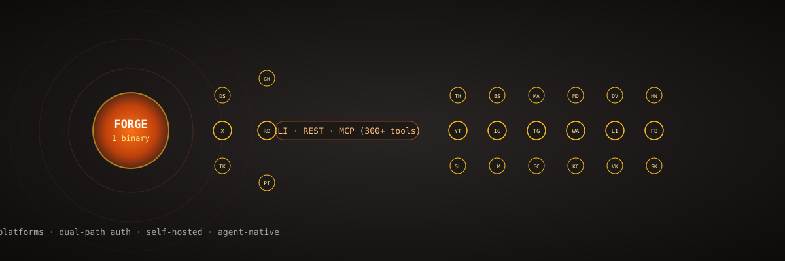

<!-- T2I HERO SPEC — Subject: a switch — a waystation that sits on its own land, taking one thing in and routing it out to a ring of 26 platform destinations. Composition: a single sturdy relay core in the centre (Rust), three labeled portals at the base (CLI terminal, REST dashboard, MCP protocol), and radiating lanes that fork and re-merge toward a ring of 26 destination glyphs (X, Reddit, LinkedIn, Instagram, Threads, YouTube, TikTok, Discord, Slack, Telegram, WhatsApp, Bluesky…). Palette: signal-blue #2563eb → slate night #0f172a, accent amber #f59e0b on the active lane, clean off-white labels. Style: flat technical vector, calm and infrastructure-like, no readable logos, no readable text, no fire, no anvil. 16:9. -->

Every document in `docs/` is listed with the question it answers in [docs/PAGE-INDEX.md](docs/PAGE-INDEX.md).

# Switchpost

<p align="center">
  
</p>

**Social posting infrastructure that runs on your own hardware. One Rust binary, 26 platforms, and your AI agent can drive it.**

Not a SaaS you rent — a service you own. No Docker required, no Redis, no Postgres, no per-seat pricing. One ~15MB binary, one SQLite file, and three interfaces into the same engine: a CLI for shell and agent use, a REST API with a real-time dashboard, and an MCP server with 389 tools for Claude, Cursor, Codex and friends.

**Pick your path:**

| You are… | Start here |
|---|---|
| An **AI agent** (Claude, Cursor, Codex) or its human | [Agent path (MCP)](#agent-path-mcp-for-ai-agents) — 389 tools, one command |
| A **solo founder / indie operator** | [Quick start](#quick-start) — build, connect, post in three commands |
| **Self-hosting** on a VPS or a spare box | [Deployment](docs/deployment.md) — systemd unit, one SQLite file |
| Weighing it against Postiz / Buffer / n8n | [How it compares](#how-it-compares) |

---

[](https://www.rust-lang.org/)

[](https://github.com/ishan-parihar/switchpost/actions/workflows/ci.yml)
[](LICENSE)
[](https://modelcontextprotocol.io/)
[](https://github.com/ishan-parihar/switchpost)
[](https://github.com/ishan-parihar/switchpost)

---

## What it is

Switchpost is a single Rust binary that manages **26 social platforms** (12 Tier-1 + 14 Tier-2, verified: `src/social/tier.rs`) through three interfaces into one shared engine:

1. **CLI** — 100+ commands for AI agents and terminal power users
2. **REST API** — SvelteKit dashboard for human operators
3. **MCP Server** — 389 tools across 44 modules for Claude/Cursor-style AI integrations

Three interfaces, one engine. Anything the dashboard can do, the CLI can do, and the MCP server can do — there is no second implementation to keep in sync.

No MCP tool name carries the project name: they are prefixed by provider (`x_*`, `posts_*`, `di_*`), so renaming or relocating this project cannot break your agent's integration.

---

## Agent path (MCP for AI agents)

If you drive your accounts from an AI agent, this is the fastest start in the file.

```bash
switchpost mcp          # stdio MCP server, 389 tools
```

```json
{
  "mcpServers": {
    "switchpost": {
      "command": "switchpost",
      "args": ["mcp"]
    }
  }
}

Then ask your agent: *"post this to X and Bluesky, and schedule the same for LinkedIn tomorrow at 9am."*
Full tool reference and session-start hooks are in [docs/agent-integration.md](docs/agent-integration.md).

```bash
switchpost mcp-tools --toolset x --pretty   # size a session before enabling a toolset
switchpost post "shipping this today" --platforms x,bluesky
switchpost posts list --state queued        # JSON by default, ready for an agent to parse
```

---

## Quick start

```bash
# Build (Rust 1.85+)
cargo build --release

# Configure (writes ~/.switchpost/.env)
./target/release/switchpost init

# Post now to X + Bluesky
switchpost post "Hello from Switchpost!" --platforms x,bluesky

# Schedule for later (ISO8601)
switchpost post "Morning post" --platforms linkedin --schedule "2026-10-01T09:00:00Z"
```

Connect an account first with `switchpost connect <provider>`, or open `/setup` in the dashboard.
The CLI self-documents: every command takes `--help`.

---

## MCP tool reference

The full tool list and namespaces are in the [agent path](#agent-path-mcp-for-ai-agents) above; tool descriptions ship inside the server, so `switchpost mcp-tools --pretty` enumerates the live set from your installed binary rather than from this page.

---

## Features

| Feature | Details |
|---------|---------|
| **Multi-platform** | 26 platforms (12 Tier-1 + 14 Tier-2), one trait-based registry |
| **Scheduling** | Cron + one-time, timezone-aware |
| **Media** | Images, videos, GIFs, carousels |
| **Analytics** | Engagement, reach, follower growth |
| **Rate limiting** | Per-platform, auto-backoff, concurrency limit + circuit breaker |
| **MCP** | 389 tools across 44 modules for agent orchestration |

---

## ☕ Support & Sponsorship

Switchpost is built and maintained by one person, self-hosted by default, and free forever under MIT.
If it saves you a subscription or an afternoon of plumbing, sponsorship keeps the platform list growing.

[](https://github.com/sponsors/ishan-parihar)
[](https://rzp.io/rzp/ishan-parihar)

Your support funds new features, releases, and infrastructure for the whole ecosystem.

---

## Configuration

All config lives in `~/.switchpost/.env` (created by `switchpost init`).
See `.env.example` for the full documented list. Nothing is required — every
value has a default:

```bash
DATABASE_URL=sqlite://data/switchpost.db?mode=rwc
APP_PASSWORD=choose-a-strong-password   # single-user gate for the WebUI
APP_URL=http://localhost:6543           # public URL (OAuth redirects)
TOKEN_ENCRYPTION_KEY=<64 hex chars>     # AES-256-GCM for tokens at rest
```

---

## Commands

| Command | Description |
|---------|-------------|
| `switchpost post "text" --platforms x,bluesky` | Create (or schedule via `--schedule`) post |
| `switchpost posts schedule <id> <at>` | Schedule an existing draft |
| `switchpost analytics get <PROVIDER>` | Get analytics |
| `switchpost mcp` | Start MCP server (stdio) |
| `switchpost config set KEY VALUE` | Manage config |
| `switchpost audit` | Disabled integrations, `--platforms` prefix collisions, writer-lock posture |

Targeting, the single-writer rule, platform tiers, and the repository layout are in [docs/platforms-and-cli.md](docs/platforms-and-cli.md). Planning, audit, and decision records are indexed in [`docs/planning/README.md`](docs/planning/README.md); the full 2026-10-14 audit is [`docs/audit/AUDIT_2026-10-14.md`](docs/audit/AUDIT_2026-10-14.md) and the 2026-10-19 session self-reflection is [`docs/planning/SESSION_2026-10-19.md`](docs/planning/SESSION_2026-10-19.md).

## Visual proof

| CLI dashboard | REST API docs | MCP tools |
|:---:|:---:|:---:|
|  |  |  |

| Content calendar | Analytics | Multi-platform |
|:---:|:---:|:---:|
|  |  |  |

## Architecture

```
┌─────────────────────────────────────────────────────────────────┐
│                        Switchpost Binary                        │
├──────────────┬──────────────────┬───────────────────────────────┤
│   CLI Mode   │   REST API Mode  │        MCP Stdio Mode         │
│   (clap)      │  (axum :6543)    │   (rmcp, 389 tools)           │
├──────────────┴──────────────────┴───────────────────────────────┤
│                    Shared Business Logic                          │
│  ┌──────────────────────────────────────────────────────────┐   │
│  │  ProviderRegistry → 26 providers (12 T1 + 14 T2, async) │   │
│  │  Scheduler → Tokio background worker (30s poll)          │   │
│  │  Auth → JWT + Argon2 + OAuth2 + Cookie dual-path         │   │
│  │  Realtime → SSE broadcast (tokio::sync::broadcast)       │   │
│  └──────────────────────────────────────────────────────────┘   │
├─────────────────────────────────────────────────────────────────┤
│                    SQLite (single .db file)                      │
└─────────────────────────────────────────────────────────────────┘
```

## How it compares

| Capability | **Switchpost** | Buffer / Hootsuite | n8n / Make | Postiz |
|---|---|---|---|---|
| **Runs on your machine, no Docker** | ✅ single ~15MB binary, one SQLite file | ❌ SaaS | ⚠️ needs nodes + infra | ❌ Next.js + Postgres + containers |
| **Token encryption at rest** | ✅ AES-256-GCM | ❌ | ❌ | ❌ (plaintext) |
| **Agent-native, all three ways** | ✅ CLI + REST + MCP, one engine | ❌ human dashboards | ⚠️ workflow only | ✅ CLI + MCP |
| **Tool names independent of the project name** | ✅ provider-prefixed (`x_*`, `posts_*`) — a rename breaks nothing | ❌ | ❌ | ❌ |
| **Platforms** | 26, trait-based registry, tiered depth | ~6–10 | via nodes | ~10 |
| **Dual-path auth** | ✅ OAuth2 + browser-cookie extraction | ❌ | ❌ | ❌ |
| **Self-hosted** | ✅ one binary, no orchestrator | ❌ SaaS | ✅ | ✅ |
| **Scheduler w/ retry** | ✅ in-process Tokio, exp-backoff, per-provider concurrency | ✅ | ✅ | ✅ |
| **Realtime SSE** | ✅ broadcast | ⚠️ | ✅ | ❌ |
| **Stage→review→publish** | ✅ | ✅ | ✅ | ✅ |
| **Installs as agent skill (AXI)** | ✅ session-start ambient context | ❌ | ❌ | ❌ |

Buffer manages your *calendar*. Postiz runs a hosted, agent-friendly scheduler at scale. Switchpost is the one
that runs **your** social operation as an agent-accessible service on **your own hardware** — schedule,
publish, moderate, monitor, and recover — from a single binary you can audit in an afternoon, with your
tokens encrypted at rest and your data in a file you control.

---

## CLI Reference

The CLI is self-documenting. Run any command with `--help`:

```bash
switchpost --help                      # All commands
switchpost x --help                    # X/Twitter operations
switchpost reddit --help               # Reddit operations
switchpost reddit mod --help           # Reddit moderation
```

### Examples

```bash
# Post to X/Twitter
switchpost x post "Shipping new features 🚀"

# Browse Reddit
switchpost reddit browse programming --sort hot --limit 10

# Vote on Reddit (requires cookie auth)
switchpost reddit vote t3_abc123 up

# Get LinkedIn analytics
switchpost linkedin analytics

# List all connected providers
switchpost providers

# Discover available targets for an integration (channels, groups, subreddits)
switchpost integrations targets <integration-id>
```

All output is JSON by default — designed for AI agent consumption.

---

## MCP Integration

For AI agents that speak MCP (Claude Desktop, Cursor, etc.):

```json
{
  "mcpServers": {
    "switchpost": {
      "command": "switchpost",
      "args": ["mcp"]
    }
  }
}
```

This exposes 389 tools with full JSON Schema descriptions. Point the command at the binary you installed; with a cargo build that is ./target/release/switchpost.

---

## Dual-Path Authentication

Switchpost implements a unique **dual-path auth** system (inspired by how browsers work):

### Cookie Auth (X, Reddit)
- Extracts session cookies directly from your browser (Chrome, Brave, Firefox, Zen)
- Enables full platform access (GraphQL API for X, voting/moderation for Reddit)
- No API key registration required
- Auto-detected on startup or submitted via web form

### OAuth (all providers)
- Standard OAuth 2.0 PKCE flow
- Managed via the onboarding dashboard at `/setup`
- Tokens encrypted at rest (AES-GCM, optional)

Priority resolution: `DB cookie tokens → Browser extraction → OAuth tokens → Env vars`

---

## Self-Hosting & Onboarding

Environment variables, tunnel and reverse-proxy setup, onboarding, and OAuth redirect URIs are in [docs/deployment.md](docs/deployment.md).

## Technical Highlights

- **Language**: Rust (Edition 2021)
- **Web Framework**: Axum 0.8
- **Database**: SQLite via sqlx (compile-time checked queries)
- **MCP**: rmcp 1.6 with 389 tools (44 modules)
- **CLI**: clap 4 with derive macros
- **TLS Fingerprinting**: wreq (Chrome 131 emulation for X/Twitter)
- **Scheduler**: Custom tokio::spawn loop with exponential-backoff retry
- **Auth**: JWT + Argon2 + OAuth2 + browser cookie extraction
- **Realtime**: SSE via tokio::sync::broadcast

### Performance
- Cold start: <500ms (binary + DB connection)
- API response: <5ms p99 (local)
- Memory: ~30MB idle
- Binary size: ~15MB (release, stripped)

---

## Requirements

- Rust 1.85+ (backend), Node 20+ with pnpm (frontend)
- Platform API credentials
- No database server — SQLite is embedded (the `.db` file is created and migrated on first run)

---

## License

MIT — [Ishan Parihar](https://github.com/ishan-parihar)

---

Skill install and the Claude Code, Codex and OpenCode session hooks are in [docs/agent-integration.md](docs/agent-integration.md).
